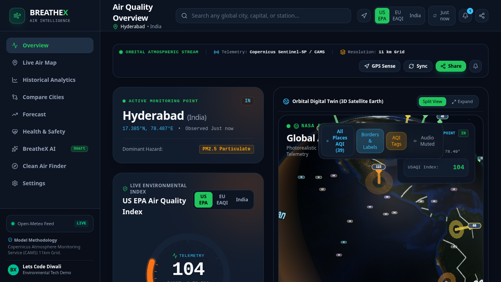
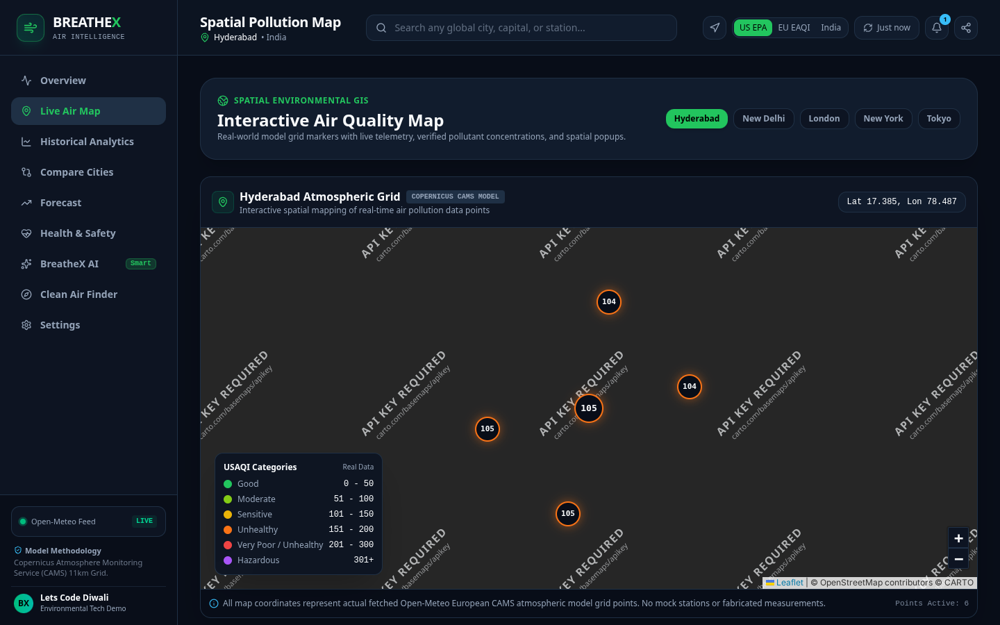
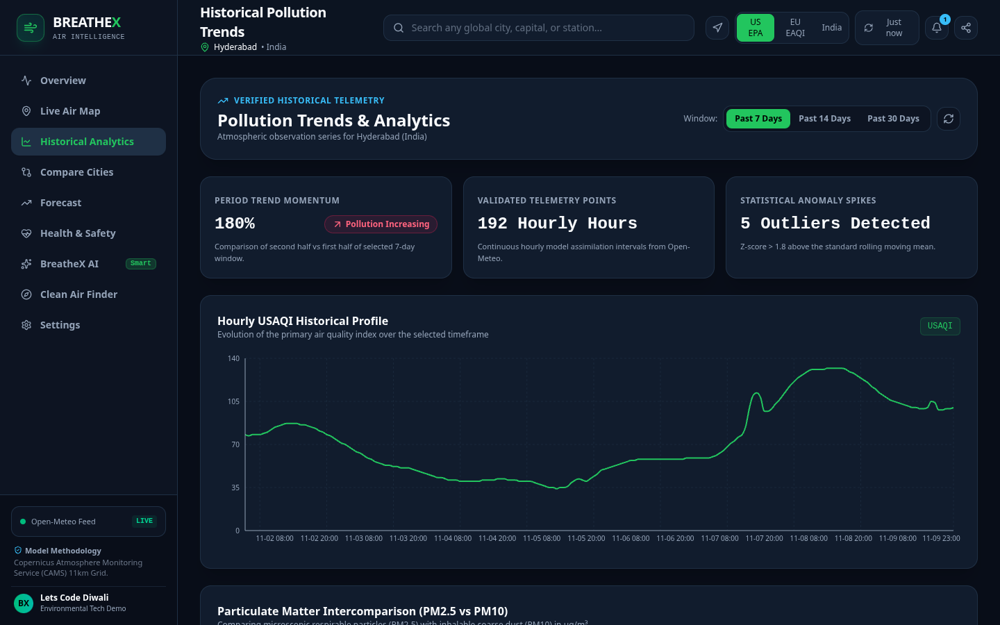

# BreatheX — Air Quality Intelligence

BreatheX is a web dashboard for exploring air-quality estimates by location, reviewing historical trends and forecasts, comparing cities, and finding general health guidance.

## Data accuracy and limitations

The primary source is the public [Open-Meteo Air Quality API](https://air-quality-api.open-meteo.com/v1/air-quality), which provides **Copernicus CAMS atmospheric model output**. These values are real, location- and time-specific model estimates; they are **not direct ground-monitor or regulatory-station measurements**. The app labels current, historical, and forecast data accordingly. Grid-map locations are sampled coordinates in the model grid, not named monitoring stations.

Open-Meteo provides European and US AQI series. The app's Indian AQI is a **PM2.5/PM10-only approximation**, not an official CPCB AQI: CPCB's official overall index may use additional pollutants and averaging periods. Missing API values are shown as unavailable rather than replaced with sample values. Forecast charts use future API timestamps only; if none are returned, the forecast is marked unavailable.

## Features

- Current AQI and available PM2.5, PM10, NO2, SO2, CO, and O3 estimates; source and model timestamp.
- Interactive Leaflet map with nearby CAMS grid-cell estimates, plus a global city directory for selecting a location.
- Historical AQI and pollutant trends, daily summaries, percentage changes, and spike analysis.
- Comparison of up to four locations using current API results.
- Forecast charts and daily outlooks based on future API timestamps, visibly separated from historical/current data.
- Health categories and general precautions, location search and browser geolocation.
- In-app threshold alerts, share cards, report export, and an optional Gemini-powered AQI assistant with voice input/output.

## Public APIs and attribution

- **Air quality, historical series, and forecasts:** [Open-Meteo Air Quality API](https://air-quality-api.open-meteo.com/v1/air-quality), using CAMS model output.
- **City search:** [Open-Meteo Geocoding API](https://geocoding-api.open-meteo.com/v1/search).
- **Weather context:** [Open-Meteo Forecast API](https://api.open-meteo.com/v1/forecast).
- **Optional assistant:** Google Gemini API, called by the Express server. The API key is read from `GEMINI_API_KEY` and is not embedded in browser code.
- **Map imagery:** Esri World Imagery and reference layers; the app also offers Carto and OpenStreetMap tile layers where configured. Keep provider attribution visible when deploying.

Open-Meteo air-quality requests are made directly from the browser and do not require an API key. Requests are cached in memory for 10 minutes; API/network failures and rate limits are surfaced in the relevant views.

## Run locally

Requirements: Node.js 20+ and npm.

```sh
npm install
```

The air-quality dashboard works without secrets. To enable the AI assistant, add a `.env` file with:

```env
GEMINI_API_KEY=your-key
PORT=3000
```

Start the app:

```sh
npm run dev
```

Open `http://localhost:3000`. To check the project:

```sh
npm run lint
npm test
npm run build
```

The production server runs with `npm start` after a successful build.

## Screenshots







## Challenge submission checklist

- **Live application URL:** deploy the app and add the public URL here.
- **Public repository:** publish this repository and verify public access.
- **Demo video (2–3 minutes):** record and add the public video URL here.
- **Implemented features:** see the feature list above. The app does not claim ground-station coverage or ML-based AQI prediction.

Deployment and demo URLs are not available in this repository yet; add them before submitting the project.
